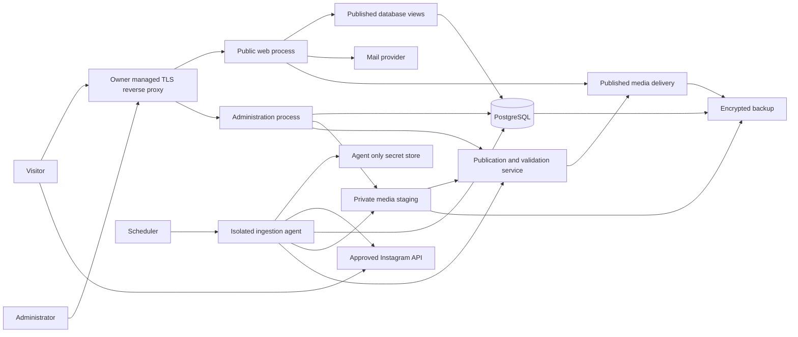
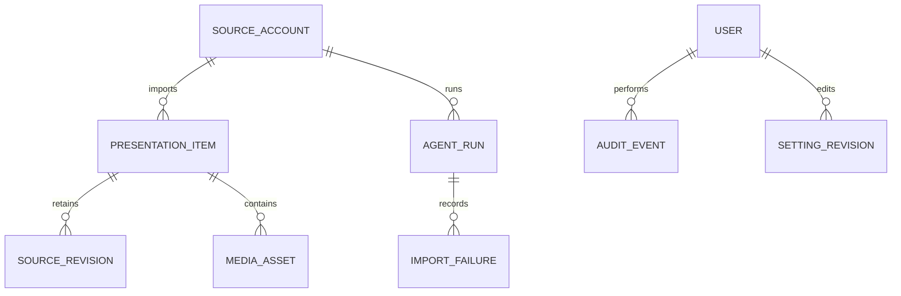

> Historical record. This document describes an earlier design or implementation;
> use the [current documentation](../../README.md) and [installation guide](../../../INSTALL.md) for current behaviour.

# Instagram website technical solution design

Version 0.2 · 19 October 2026 · Draft for owner review · No implementation authorised by this document

This design translates the supplied functional specification into an implementation plan. It is intended for the owner, developers and operator. Decisions marked **Proposed** or **Assumed** require confirmation; they are not additions to the approved business scope. The original Word document plus [owner decisions](owner-decisions.md) form the functional source of truth; later owner decisions override conflicting draft defaults. The pasted technical-design prompt is a request to produce this design, not an existing technical specification. No application code, infrastructure or accounts have been created.

## 1. Executive summary

Build a bilingual, database-backed public website with Main Feed, Contact and Reviews, a protected administration interface and an independently deployed Instagram ingestion process. Prefer a server-rendered Django application with PostgreSQL, restricted media storage and a dedicated Docker scheduler. One repository can contain the components, but their runtime identities, credentials and access rights must remain separate.

The public application reads only eligible published content. The administration process edits content and settings. The agent alone receives Instagram authorisation material and updates imported source data. Instagram outages must not prevent visitors from viewing previously published content. Email acceptance is required before showing a contact success message.

The owner has a personal Instagram account. Recommend conversion to Creator and Instagram Login OAuth, with encrypted agent-only tokens, not password-based access. Meta’s official collection supports professional accounts and does not require a linked Facebook Page for this route. Account conversion is not yet approved, and a live integration proof remains necessary. [Meta Instagram Login collection](https://www.postman.com/meta/instagram/folder/6raa77c/instagram-api-with-instagram-login).

Confirmed owner decisions: automatic publication after validation; captions only, no comments or messages; embeds preferred with local-media fallback; Docker deployment behind owner-managed infrastructure/SSL; multilingual interface while posts retain their original language; one admin, no mandatory MFA. Reviews population, mail provider, application stack and retention remain open. [Decision record and integration contract](owner-decisions.md).

## 2. Scope

**In scope:** one site and one authorised Instagram source; all numbered functional requirements; controlled header/footer editing; theme and bilingual content; search and editorial overrides; managed reviews; email contact delivery; credential isolation; scheduled incremental import; audit, backup, monitoring and operational instructions.

**Excluded:** Instagram publishing, likes, comments or DMs initiated by the site; social user accounts; payments; multi-tenancy; automatic translation; advanced visitor analytics; public review submissions. REV-003 is a required scope boundary, not a requirement to implement a submission form.

**Future options:** public moderated reviews, CDN or object storage and distributed workers. Comment/message ingestion, post translations, extra administrative roles and MFA are not initial requirements under the owner decisions. Carousels are optional in the source; the schema accommodates ordered media, while the initial UI may show the first image and a source link.

## 3. Requirement analysis

[requirements.md](requirements.md) records every numbered source requirement and additional identifiers for meaningful unnumbered data, operational and non-functional requirements. Each entry has its source, priority, dependencies, acceptance summary and design impact. Source IDs remain unchanged; new IDs identify extracted requirements rather than renumbering the source. [acceptance-criteria.md](acceptance-criteria.md) and [traceability.md](traceability.md) provide the verification contract and component mapping.

Resolve these contradictions or ambiguities explicitly:

- AGT-001–005 refer to login credentials; A-07 and SEC-012 require permitted platform access. Recommend OAuth/API tokens and an agent-only provisioning path, subject to permission verification.
- The owner prefers embeds. Provider embed controls must remain intact with a separate visible source link; local media uses a source-linked image/poster and separate video controls. This amends the original primary-media-click rule where an official embed owns its interactions; verify the final layout with the owner.
- FEED-001 uses display/source dates while ADM-005 exposes sort priority. Propose priority descending, effective display date descending, source date descending, ID descending; confirm whether priority should override dates.
- “Source unavailable” is not in the publication-state list. Keep source availability independent of editorial publication status.
- AGT-013 calls for immediate authentication alerts; workflow 15.4 mentions thresholds. Authentication failures alert immediately, transient failures alert at the proposed repeated-failure threshold.
- L10N-001 requires EN/FR selection, while ADM-008 permits disabling a locale. Display only enabled choices and keep at least one enabled; confirm whether both must always remain available.
- The source distinguishes original values from editable display fields without specifying overwrite behaviour. Retain versioned source snapshots and explicit editorial overrides; ingestion never replaces overrides.

## 4. Assumptions and constraints

**Confirmed:** responsive internet-facing website; EN/FR; one account/site; separate agent; no Instagram secrets in the website; at least 10,000 entries; source-defined browser, accessibility, availability and response targets; Draft functional document version 1.0 dated 23 July 2026.

**Inferred:** ingestion and contact email require outbound internet; previously imported content is independent of live Instagram responses; the owner has permission to reuse source media. The latter requires evidence before importing production media.

**Confirmed amendments:** one owner/admin, MFA not required; owner manages infrastructure and TLS; Docker deployment; new valid imports auto-publish; captions only, excluding comments and messages; embed first, otherwise permitted local media; original-language posts on every site locale.

**Proposed assumptions:** owner-only infrastructure operations; six-hour import interval; 12-item page size; seven-day import look-back plus weekly reconciliation of known source IDs; manual reviews and translations of site copy only; English default; Europe/London display timezone until the owner specifies another. Browser locale never determines the site's timezone.

**Capacity assumptions:** 10,000 posts, 50 concurrent visitors, 10 public requests/second sustained, up to 100 imports/run. Initial host sizing is 2 vCPU and 4 GiB RAM plus separately sized database/media/backup storage; benchmark before procurement. No firmware, native mobile app, hardware or offline authoring is required.

**Open constraints:** Docker host resources/budget; application stack confirmation; residency; email provider; account-conversion approval and API permissions; historic import size; embed integration details; retention; deployment domain; identity and visual assets. Defaults permit design completion, not production launch.

## 5. Proposed architecture

**Recommendation:** modular monolith for web business logic, deployed as separate public and administration processes, with an isolated batch agent. This keeps transactions and operations simple without granting the public process administrative or Instagram privileges. Django supplies models, templates and an extensible admin foundation; the particular architecture is this design's recommendation. [Django overview](https://docs.djangoproject.com/en/5.2/intro/overview/).

The publication service is a shared trusted module used by administration and agent processes, not an additional publicly callable service. It validates content and media eligibility before updating publication state. Public media lives outside the executable application tree. Draft media remains private; public delivery checks database publication eligibility so guessing a draft URL cannot expose it.

Trust boundaries are internet/proxy, public/admin runtimes, private database, private media staging, published media delivery, agent secrets and third-party APIs. Only proxy routes to application ports; database has no public listener. The scheduled agent has no permanent inbound HTTP listener. OAuth provisioning may use an isolated temporary operator-only callback, outside the web application; see the owner decision contract. Process/container isolation limits compromise, while a shared host remains a residual common failure boundary. Scale public workers first; keep one importer per account.

## 6. Component design

| Component and owned state | Inputs and outputs | Internal responsibilities and dependencies | Security, failure and recovery | Scaling and verification |
| --- | --- | --- | --- | --- |
| Public web | GET locale/page; contact fields → HTML, mail request | Feed/reviews queries, locale resolver, forms, metadata; published DB views and mail | No admin routes or agent mounts; safe 503 when DB fails; neutral retry on mail failure | Stateless workers, shared limits; publication, locale and contact integration/E2E tests |
| Administration | Authenticated settings/content/upload forms → revisions and audit | Django admin extensions, permission checks, validation, preview, optimistic version checks | Admin-only DB identity; fail transaction if audit fails; reject stale updates with conflict | One admin; test unauthenticated denial, XSS, CSRF and stale edits across tabs |
| PostgreSQL | Parameterised queries → records and constraints | Content, settings revisions, users, sessions, events, importer checkpoints | Public views only, admin scoped writes, agent source-only writes, separate migration owner | Indexed lists; backup/restore, permissions, constraint and load tests |
| Media subsystem | Validated embed descriptor or streamed API/admin bytes → media presentation and private assets | Type detection, dimensions, checksum, quota, safe naming, promotion and delivery | Reject executables, SVG and mismatched types; retain old asset until replacement validates | Disk initially; object storage adapter later; malformed-file, path and unpublished-media tests |
| Agent | Scheduled run/config → source snapshots, media, metrics | API adapter, incremental reader, normaliser, bounded downloader, upserter, reconciliation | Sole secret reader; fail closed on auth; no overwrite of edits; retry from committed state | Account-scoped lock; contract, replay and failure-injection tests |
| Credential operator path | Interactive agent-host provisioning → validated encrypted token version | Secrets adapter, authentication probe, rotation; no credential export | Operator provisions through protected input; runtime decrypts only in memory; failed rotation preserves old active version | Rare use; mount/permission and redaction tests |
| Scheduler/operator | Timetable/manual trigger → non-overlapping run | Dedicated scheduler container, backup/retention timers and alert hooks | Lock plus deadline; no public import trigger; restore after interrupted run | One active run; overlap/reboot and recovery drills |

Django's admin is a foundation, not permission to expose arbitrary database edits. Custom services enforce sanitisation, source/display separation, settings validation and audit across all entry points.

## 7. Platform specific design

### Web application

Server-rendered templates and responsive CSS are preferred. Small progressive JavaScript controls handle preview, read-more, official embed loading and local playback; core navigation, pagination, locale switching and contact submission work without JavaScript. When an embed cannot load, show the canonical source link and any validated local fallback. Form state lives on the server and in normal form controls, not a global client store. Clients provide immediate feedback; server validation is authoritative.

Use `/en/` and `/fr/` prefixes for deterministic content and indexing, including `/en/contact/` and `/en/reviews/`. `/` redirects using an enabled saved locale, then browser preference, then configured default. Emit `lang`, canonical URLs, locale alternates and configurable title/description/social metadata. Never put private media or administration in the sitemap. No service worker or offline contact queue is proposed.

Render header, navigation, content card, footer, locale selector and form feedback as shared components. Self-host approved fonts. Sanitised markup cannot replace required navigation or language controls. Theme values become validated CSS variables; raw CSS and arbitrary remote URLs are prohibited. Use mobile-first widths and test at 320, 768 and 1440 CSS pixels, 200% zoom and keyboard-only navigation. Target WCAG 2.2 AA, with labelled fields, focus indicators, live error summaries and no autoplay. A theme must preserve measured text contrast or be rejected. Dark mode is optional and deferred unless requested.

Do not cache public feed HTML in the initial release: hidden posts must disappear on the next query. Static fingerprinted assets can be cached indefinitely; public media responses must revalidate eligibility on subsequent requests. Private admin responses are `no-store`. Optional CDN introduction requires purge and privacy tests.

### Backend services

Use Django forms, domain services and ORM transactions. HTML forms are the initial interface; do not introduce a public JSON API without a consumer. Stable internal adapter/data contracts carry a `schema_version`. External API version is an explicit agent setting after verification. Admin routes are mounted only in the admin process behind the configured slug.

Use PostgreSQL-backed shared counters for low-volume rate limits initially; do not use per-worker memory for enforcement. Use a transaction and version field for settings/content edits; stale writes return conflict and preserve both users' inputs. No broker is required: a dedicated Docker scheduler invokes the agent batch process using a shared account lock; email is synchronously submitted with a strict timeout, and cleanup runs via scheduler. Add a durable encrypted queue only if delivery requirements later justify retaining messages.

Proposed limits: database statement timeout 3 seconds for public reads; outbound connect timeout 5 seconds; mail operation deadline 10 seconds; API request deadline 30 seconds; media download deadline 120 seconds and byte cap; import run deadline 20 minutes. Respect provider limits and Retry-After, using at most three retries after the first attempt with 1/4/16 second jittered backoff. Long Retry-After values defer to a later run. Never automatically retry an ambiguous email submission without provider idempotency support.

## 8. Technology recommendations

These are recommendations, not an installed stack. Select supported patches and pin exact versions and container digests at implementation time. Prefer Django 5.2 LTS while supported; review its support window before project setup. The official release table identifies supported branches. [Django downloads and support](https://www.djangoproject.com/download/).

| Category / preferred option | Use and reason | Trade-off, licence and hosting | Alternative and why not preferred |
| --- | --- | --- | --- |
| Python / Django | Web, admin and shared domain logic; single language for ingestion | PSF / BSD respectively; Linux runtime; dependency and security maintenance required | TypeScript web stack; viable if team preference, but requires selecting more admin/auth tooling |
| Django templates / native CSS and JS | Server-rendered public pages and forms; minimal build/runtime complexity | Django BSD; custom assets owned by project, fonts require licence review; no separate Node server | React/Next.js; extra state and build concerns for three content pages |
| PostgreSQL 18 supported patch | Transactions, search indexes, roles and audit relations | PostgreSQL licence; private service with persistent volume and backups; more operation than embedded DB | SQLite; fine for disposable local experiments, less suitable for separate concurrent writers and DB roles |
| Docker scheduler container / host timer alternative | Invoke isolated agent at configurable intervals without web traffic | Docker/Compose deployment with persistent state; scheduler dependency licence pinned/reviewed; do not mount Docker socket | Owner-managed host timer is viable; Celery/Redis deferred as unnecessary initial services |
| Private filesystem media | Provider-independent initial storage and easy local inspection | Requires quota, backup and eligible-file delivery; limit single-host coupling | S3-compatible storage is preferred when host lacks durable volumes or workers multiply; provider charges and access policy required |
| Django sessions / Argon2id dependency | Named admin accounts, session auth and password hashing | Django BSD; exact hashing library licence reviewed in lockfile; tune on production hardware | External OIDC provider reduces password operations but adds vendor and availability dependency |
| SMTP or HTTPS mail adapter | Domain-authenticated contact delivery | Provider and residency unselected; TLS and outbound network required; no price assumed | Local MTA requires more deliverability operation; avoid unless already maintained |
| Supported WSGI server behind owner proxy | Serve public/admin containers; owner terminates TLS | App server selected and licence reviewed at setup; no project-managed SSL service | Any owner-selected proxy supporting required routing/headers; no Nginx dependency imposed |
| pytest / Playwright / axe tooling | Domain, DB, browser and accessibility verification | MIT / Apache-2.0 / MPL-2.0 respectively; confirm exact packages; test browser runners need CI resources | Manual-only testing is insufficient for permissions and importer replay; unittest viable if team prefers |
| Ruff / type checker / dependency scanner | Formatting, static checks and controlled dependencies | Select pinned supported packages and record SPDX licences; developer/CI tools only | Equivalent maintained tools acceptable; no particular vendor required |
| CI runner / structured logs and health monitor | Build checks, immutable artifacts and alerts | Existing Git host CI if available; commercial terms depend on account; logs need access/retention | Self-hosted runner/monitor if residency dictates; no new service required by design |

No embedded, mobile, message-broker or hardware technology is applicable. A secret manager is preferred where already provided; otherwise use an agent-only encrypted token file with an OS-protected key supplied separately at runtime. Encryption-library choice and key format must be reviewed before implementation.

## 9. Data design

All entities use opaque UUID primary keys unless naturally keyed; timestamps are UTC. The site owns its records; a single configured source account owns imported items. Optional fields are explicitly nullable, not sentinel strings. Sensitive classifications are public, internal, personal and secret.

| Entity | Required fields / optional fields | Validation, state and lifecycle |
| --- | --- | --- |
| users | ID, unique normalised login, password hash, role fixed to Owner, enabled, created/updated; optional verified email/last login | One named Owner account; no Editor role required; never return hashes; personal/internal; deactivate rather than remove audit actor |
| site_settings and revisions | key, type, validated value, locale or global, revision, editor, timestamps | Enabled locales nonempty and include default; fonts allowlisted; recipient internal/personal; previous version available for rollback |
| source_accounts | platform, source ID, integration mode, enabled, credential reference, checkpoint | Unique platform/account; non-secret reference only; actual secrets outside application database |
| presentation_items | source identifiers, canonical URL, source timestamp, original caption, status, publish_at, display_date, priority, version; optional EN/FR alternative text; caption display uses original source language | Unique platform/account/post; Draft, Published, Hidden, Error, Archived; availability separately Available/Unknown/Unavailable; auto-import cannot modify editorial columns |
| source_revisions | item, import time, source caption, safe media metadata, import hash, adapter version | Append on source change; retain original values without credential URLs or tokens; support comparison with editorial display |
| media_assets | item or theme owner, type, private key, checksum, MIME, size, sequence, validation status; optional poster, dimensions, duration, caption track | Presentation may be embed (validated source descriptor) or local asset; exactly one owner; generated local path; unique sequence per item; no executable extension; assets remain private until owner qualifies |
| reviews | name, EN/FR text, status, priority, published_at; optional rating, source name/URL | At least one locale text; proposed rating integer 1–5; approved publication only; no public submission endpoint |
| contact_delivery_events | random submission key, time, status, recipient revision, attempt metadata; optional provider ID/safe error code | Pending, Accepted, Failed, Unknown; never visitor email, phone, topic or message body in DB; personal provider metadata access restricted |
| agent_runs and import_failures | run/account IDs, start, status and counters; optional finish, error codes, failed source IDs | Running, Succeeded, Partial, Failed, Interrupted; per-item failures retained for retries; no response dumps containing credentials |
| audit_events | actor or system identity, timestamp, action, entity, field names, revision pointer, correlation ID | Append only for application roles; summaries exclude secret and contact values; content revisions supply auditable original values |
| sessions / limit counters | opaque session key, expiry, scoped counter and window | Internal or personal; TTL cleanup; no tokens exposed to browser storage beyond secure session cookie |

**Public eligibility:** status Published, publish_at not null and at or before database current time, at least one validated eligible embed descriptor or local medium. Apply equivalent review eligibility. Default publish_at is assigned explicitly by publication operation. Date edits must not silently publish. Effective display date is display_date, otherwise source timestamp; source timestamp and ID break ties. Priority ordering remains subject to confirmation.

Use separate public views for eligible items, reviews, public settings and eligible media. Public role cannot select base content, sessions, users, audit or agent tables. Grant the public process narrowly scoped insert/update privileges for contact events and counters only; do not grant arbitrary configuration writes. The agent can write source columns/revisions, import state and assets; narrowly scoped publication operations enforce the configured default and preserve editor overrides. Admin role edits approved business tables, not DB ownership. PostgreSQL separates object privileges; these grants must be demonstrated by tests using the actual runtime identities. [PostgreSQL privileges](https://www.postgresql.org/docs/current/ddl-priv.html).

Indexes: unique source tuple; published status/publish_at and effective date/ID; review status/order/date; source account/run timestamp; audit entity/time; searchable source IDs/URLs; PostgreSQL text/trigram search over original captions and any retained legacy display text after testing multilingual matching. Use bounded indexed queries and eagerly fetch media. No partitioning at 10,000 records.

Archive is a soft editorial action. Proposed source-deletion policy is request review without changing current publication on a single inconclusive response. Explicit confirmed deletion may hide after owner approval of policy. Hard purge is an operator-controlled retention workflow: unpublish first, revoke media delivery, remove unused assets after reference checks, expire backups on their retention schedule. Old source revisions are retained while the item exists unless policy requires earlier removal.

Media descriptors include presentation mode, validated embed canonical URL/provider identifier, last eligibility check, local fallback asset reference and safe failure code. The trusted embed component is the only exception to the no-third-party-script/frame policy; its exact origins and response validation are established in the integration proof. See [owner decisions](owner-decisions.md) for runtime fallback and privacy rules.

## 10. API and interface design

Interfaces are proposed contracts, not implemented endpoints. Admin route examples use `{manage}` for the configured slug; no `/api` duplication is needed initially. All HTTP input is size bounded, version checked on edits and validated server-side. Pages use native HTML responses; domain services return typed results. No event broker or delivery stream is proposed.

| Interface and producer → consumer | Protocol and auth | Inputs / outputs | Error, timeout, retry and idempotency |
| --- | --- | --- | --- |
| Public feed/reviews, DB → visitor | GET `/en/`, `/fr/`, locale reviews; anonymous HTTPS | Valid locale, bounded cursor/page; eligible cards, next page and metadata | 400 invalid page, 503 DB failure; 3-second query limit; read retry safe; deterministic ordering |
| Locale selection, browser → web | Same-origin POST `/locale/`, CSRF | Enabled locale, safe local next path; signed/validated preference and redirect | Reject disabled locale/open redirect; safe repeat; 30-day proposed preference TTL |
| Contact, visitor → mail adapter | POST locale contact, CSRF and abuse controls | Topic 1–150, body 10–5000, email ≤254, phone optional 7–30, submission key; localised receipt state | 400 field error, 429 limit, 503 failure/unknown; 10-second mail deadline; duplicate key never sends twice automatically |
| Login/logout, administrator → admin | HTTPS session and CSRF | Single-admin login/password; rotated session or generic failure | No account enumeration; 429 throttling; no unsafe automatic POST retry |
| Content/reviews, admin → domain service | GET search and POST `{manage}/items/{id}/` or reviews; role permission | Query/status/date/cursor; editable overrides, dates, media, version; saved revision | 403 unauthorised, 404 absent, 409 stale; atomic write and audit; repeat with same operation key returns prior result |
| Settings/theme, admin → service | GET/POST `{manage}/settings/`; Owner | Typed setting, locale, revision, safe markup/media reference; preview and saved revision | Reject unsafe values; 409 stale; no mail recipient exposure publicly; preview does not publish |
| Upload, admin → media service | Multipart POST `{manage}/media/`; permitted editor + CSRF | Capped bytes and purpose; opaque validated asset ID | 413 cap, 415 unsupported/mismatch; deadline 120 seconds; no server fetching arbitrary replacement URLs |
| Instagram adapter, agent → Meta | Versioned HTTPS API, agent-only token | Verified account/media fields and pagination cursor; normalised source post records | Validate IDs, timestamps, canonical links and response schema; bounded retries; stop auth errors; external contract verified before build |
| Media download, agent → approved origin | HTTPS stream, no forwarded credentials | API-provided approved URL; bounded bytes and checksum | Validate redirects and resolved public IP every hop; reject private/link-local targets and size/type failures; staged write; 120-second deadline |
| Credentials, operator → agent store | Local protected terminal/secret-manager provisioning | Non-echoed authorisation material and expected account ID; validation result and secret version only | Never secret argv or output; failed probe leaves old secret active; no HTTP export API |
| Import run, scheduler → agent | Dedicated container identity, internal schema v1 | Account ID, bounded look-back/force mode; run summary and exit category | Non-blocking account lock; 20-minute deadline; persisted item progress; safe replay; force never overrides edits |
| Health, monitor → runtime | Minimal public liveness, protected readiness | No input; status only | No secrets/versions in public result; dependency checks only on private readiness; 2-second check deadline |

Mail producer uses a domain-controlled From and validated visitor Reply-To, never user-controlled headers. Topic is plain subject text with CR/LF rejected. An event is Accepted only on explicit provider acceptance, not inbox delivery. Submission keys are unpredictable, browser-bound and retained for a proposed 24 hours. If the process crashes after sending but before recording acceptance, status becomes Unknown; do not retry automatically. Provider-supported idempotency is preferred and must be verified when a provider is chosen. SMTP alone cannot guarantee exactly-once delivery.

The agent upserts by source tuple, resolves a supported embed first or stages a permitted validated local fallback, then commits metadata and checkpoint transactionally. Original captions are stored without translation and no messages/comments are requested. Publication is automatic for complete valid new records; malformed/incomplete records enter Error/retry. Existing Hidden/Archived decisions and editorial overrides are preserved. It records per-item failures before advancing page progress; failures are retried independently of the high-water mark. A look-back alone cannot detect all historical changes, so weekly full known-ID reconciliation is proposed with a rate budget and resumable cursor. Missing from one listing is not proof of deletion.

## 11. User interface and experience design

| Screen / user | Purpose, information and actions | Data and permission | Error and alternate states |
| --- | --- | --- | --- |
| Main Feed / visitor | Identity, navigation, media/text, date, source link, pagination, locale | Eligible public items/settings; anonymous | Configured empty message; safe 503; media failure poster; loading indicators only for enhancements |
| Contact / visitor | Topic, message, email, optional phone, privacy link and submit | Public resources; recipient server-side only | Inline errors and summary; sending state; accepted confirmation; failed/unknown retry guidance without false success |
| Reviews / visitor | Approved text, name, optional rating/source/date | Published review view | Localised empty state; source link safe; 503 on data failure |
| Login / administrator | Login/password fields and recovery guidance; no required MFA | Admin runtime only | Generic invalid login; throttling message; expired session |
| Entries/search/edit / Owner | Caption/ID/URL/status/date search; original-language caption and editorial override in the same language, locale alt text, dates, priority, media, status | Business tables, per-action permission | Empty results; validation errors; stale-version conflict; unsaved changes warning |
| Reviews/edit / Owner | Create, translate, reorder, approve/hide reviews | Review and audit permissions | Validation, missing translation warning, stale save conflict |
| Site settings/preview / Owner | Header/footer, approved colours/fonts, background, locale resources, recipient | Typed settings/revisions; no Instagram secrets | Sanitisation feedback, contrast failure, invalid address, preview and rollback |
| Audit/import status / Owner | Safe change summaries, run counters, failures and timestamps | Read-only safe event projections | Redacted operational codes; no credential button or raw API responses |
| Provisioning / operator | Agent-only credential entry, validation and rotation instructions | Host identity, outside website | No reusable secret displayed; actionable account/permission error only |

Navigation always retains Feed, Contact, Reviews and the enabled locale choices. Confirmation is required within the product before hiding a published item, bulk edits and settings rollback; non-destructive edits have a preview and clear save action. Show dates/numbers in selected locale and site timezone with timezone context in admin. Site-copy/review locale fields fall back to configured default then other available content. Imported captions remain in the original language on every locale and do not use caption translation fields; do not machine-translate. Fixed labels fall back to packaged translations, never blank labels. Django provides translation and formatting mechanisms; database overrides are this design's extension. [Django internationalisation](https://docs.djangoproject.com/en/5.2/topics/i18n/).

## 12. Authentication and authorisation

Visitors have no accounts. **Confirmed:** one named Owner administrator with password/session authentication. No Editor role or MFA feature is required for the initial release. The operator is a separate host identity, not an admin role with a secret-export capability. Account provisioning/recovery is operator-controlled until email verification is configured. No shared accounts or public registration.

Prefer Django's session authentication and permission framework, configured for the single Owner and session expiry. [Django authentication](https://docs.djangoproject.com/en/5.2/topics/auth/). Proposed password rule: minimum 14 characters, accept long passphrases and reject common/compromised passwords; tune Argon2id to the production host. Never place password hashes or tokens in logs. Rehash upon successful login when parameters change.

Use database-backed sessions, secure HttpOnly SameSite=Lax session cookie, session rotation at login and privilege changes, 30-minute idle and 12-hour absolute expiry. Logout and account disable revoke server sessions. Require recent password reauthentication for recipient changes and account security changes. Recovery uses an expiring one-use out-of-band token to a verified address, or a documented operator reset without a production password in commands. MFA is not required by the owner; no TOTP seed or recovery-code feature is needed initially. Keep strong password hashing, login throttles, secure sessions and operator-controlled recovery.

Proposed throttles: login 5 failed attempts per account/15 minutes plus 20 per IP/15 minutes; contact 5 attempts/IP/hour plus site cap 100/hour; adjust for NAT and abuse evidence. Do not permanently lock accounts based solely on remote failures. Shared limits use pseudonymous keyed hashes with short retention; no raw message content. All state-changing admin actions check session, permission and CSRF token. Restrict DB/admin ports to the private network and optionally an operator VPN.

## 13. Security design

Threat actors include anonymous abusers, compromised administrator browsers, malicious uploads, exposed credentials and compromised dependencies. Assets include admin sessions, Instagram authorisation, unpublished content, contact details and backup keys.

| Threat / attack path | Required or proposed mitigation | Evidence before release |
| --- | --- | --- |
| Anonymous admin access or direct object access | Authenticate every handler and enforce action permissions in domain service; admin routes absent in public process | Anonymous HTTP denial and per-runtime DB identity tests |
| Credential theft via compromised web | Agent secrets/key directory not mounted to either web runtime; separate DB roles; non-root processes and restricted egress | Attempt reads/decryption with public and admin service identities; all denied |
| Stored XSS through markup, captions or links | Allowlist sanitiser; escape imported plain text; permit only safe tags and https/mailto links as appropriate; no scripts, events, iframes, raw style or SVG | Attack corpus plus real-browser tests |
| CSRF, session theft, clickjacking | CSRF middleware, secure cookies, TLS, reauth, restrictive frame policy and referrer policy | Cross-origin POST and cookie assertions |
| SQL injection or unrestricted search | Parameterised ORM queries, bounded fields and query lengths; no raw admin SQL | Query abuse tests and static review |
| SSRF/media URL or redirect abuse | Agent-only fetching; approved media hosts and public IP checks at each resolution/redirect; egress denies internal/metadata networks; strict time/byte caps | DNS/redirect/private-IP fixture tests |
| Malicious/oversized media or path traversal | Magic/type match, decode caps, generated keys, non-executable storage, strip metadata where practical; raster backgrounds only | Polyglot, decompression bomb, extension and traversal tests |
| API/mail abuse, injection or replay | Shared throttles, CSRF, honeypot, capped fields, safe headers, submission keys | Concurrent duplicate, rate-limit and CR/LF tests |
| Secret leakage in errors/backups | Structured allowlisted logs; redact auth headers, query tokens and provider payloads; encrypt backups and separately protect keys | Automated secret-pattern fixture scan and restore access test |
| Supply chain compromise or debugger exposure | Pinned dependencies/images, scans, SBOM, no debug in production; private readiness, no shell/debug endpoints | Release checks and exposed-route probe |
| Token replay or MITM | TLS with certificate validation, least permissions, no bearer tokens in URLs where provider supports headers, rotation/revocation | Provider integration review; redaction test when API requires URL credentials |
| Draft asset leakage or stale publication | Private staging and DB eligibility gate on media delivery; no initial HTML CDN cache; revalidate media | Fetch guessed draft paths, hide item then refetch page/media |

CSP recommendation: default source self; scripts self with nonces only when essential; no unsafe-inline scripts; explicitly allow only verified official embed loader origins; object source none; base URI self; frame ancestors none; frame source restricted to the verified Instagram embed origin; approved same-origin local media/fonts and constrained images. Header/footer sanitisation still rejects arbitrary script/iframe markup; embeds are a trusted dedicated component. Theme customisation uses validated values rendered through the trusted stylesheet mechanism, not raw style strings. Enable HTTPS redirect and HSTS only after domain/TLS validation. Trust forwarded headers solely from the configured reverse proxy. Django's deployment and security guidance are implementation references; sanitisation and throttling require explicit configuration/extensions; MFA is not required. [Deployment checklist](https://docs.djangoproject.com/en/5.2/howto/deployment/checklist/), [Django security](https://docs.djangoproject.com/en/5.2/topics/security/).

Raw arbitrary header/footer HTML and password-based scraping would weaken the intended boundary; neither is the proposed implementation. Firmware attacks and hardware debug threats are inapplicable.

## 14. Privacy and data protection

Collect visitor email/phone/topic/body only to send the enquiry. Keep these in request memory until provider submission; do not persist them in application event logs or tracing. The mail provider and recipient mailbox necessarily receive the contents. Official embeds also send browser requests to Instagram; privacy/consent text must cover this third-party media processing, with source-link/local fallback when embeds are blocked. The owner must approve their retention, residency and processor arrangements; no legal basis is assumed here.

Proposed retention: contact delivery metadata and application logs 30 days; pseudonymous abuse counters at most 24 hours after window expiry; admin audit 12 months; agent run detail 90 days; encrypted backups 30 daily restore points. Keep published media until unpublishing/deletion policy applies; run reference-aware cleanup after a proposed 7-day recovery window. These are design defaults awaiting owner approval, and external platform deletion requirements take precedence where applicable.

Admin names/emails, review display names, captions, media and any identifiable source content require controlled exports and deletion procedures. Do not import comments until their purpose and permission are confirmed. Add configurable privacy text and any cookie notice justified by actual cookies; no tracking analytics is proposed. Explain the locale preference and necessary admin cookies. Export records only to an authorised requester through the operator; redact unrelated identities. Deletion first removes live publication and private derivatives, then propagates to provider/storage processes as applicable; backups expire by schedule, and restore must reapply a deletion ledger. Privacy/legal review determines final notice, basis, rights and periods.

## 15. Reliability and resilience

| Failure | Behaviour, recovery and alert |
| --- | --- |
| Instagram/API/network unavailable | Keep last valid published data; bounded transient retry, record failure; alert after 3 consecutive failed scheduled runs (proposed) |
| Authentication expired/revoked | Stop run; immediate high-priority operator alert; reauthorise outside website; no password fallback |
| Invalid response or partial media | Record per-item failure; retain valid old revision/assets; only advance durable processing state with retryable failure recorded |
| DB unavailable | Public safe 503; admin changes not acknowledged; importer stops without checkpoint advance; retry later; alert after 5 minutes proposed |
| Mail failure or ambiguous timeout | Never show accepted unless confirmed; Failed/Unknown event; explain uncertainty; no blind automated retry |
| Disk quota/full or corrupt asset | Stop affected download before publication; keep previous asset; alert at 80% warning/90% critical and on write failure |
| Process/host restart mid-import | OS restarts services; stale Running run becomes Interrupted; account lock released with DB session; replay from committed cursor |
| Concurrent scheduler/manual run | Non-blocking per-account database advisory lock; skip second run with safe outcome; never import concurrently |
| Partial deployment or incompatible schema | Readiness fails, do not route traffic; revert compatible image; preserve schema unless tested reverse migration |
| Clock drift | UTC host synchronisation monitored; reject implausibly future source dates; publish eligibility uses database clock; alert on measured drift >60 seconds proposed |
| Visitor loses network | Previously loaded document remains visible; no guaranteed offline browsing; contact does not queue silently; retain entered fields while tab remains open |

Proposed recovery objectives are RPO 24 hours and RTO 4 hours for site/database/media. Daily encrypted off-host backups must include a consistent database snapshot and referenced immutable media manifest. Backup keys are protected independently; agent secret backup is a separate restricted procedure or reauthorisation. Restore to isolated staging monthly, verify media checksums and publication, reapply deletions, suppress mail and importer until validated, then resume. PostgreSQL supports dump, filesystem and continuous-archive approaches; choose dump-plus-media manifest initially, PITR if approved RPO requires it. [PostgreSQL backup guidance](https://www.postgresql.org/docs/18/backup.html).

## 16. Performance and scalability

Source targets: server response below 2 seconds under normal load (excluding unusually large media), 99.5% monthly availability excluding planned maintenance, at least 10,000 entries, indexed paginated lists and resized/lazy images. **Proposed measurement:** p95 application response <2 seconds at 10 requests/second and 50 concurrent visitor sessions over 15 minutes with 10,000 seeded items; report cold/warm behaviour separately. Measure availability using one-minute external checks, documenting maintenance windows and error budget.

Initial page size 12, maximum 48; admin maximum 100. Prefer stable keyset cursors; sanitise and cap search to 200 characters. Use responsive raster variants, explicit dimensions, lazy-loading below-fold media, video posters and preload none. Proposed image cap 20 MiB input and 40 megapixels decoded; backgrounds 10 MiB; optional video 200 MiB and 5 minutes. Validate these with real source media before launch. Original required source metadata survives media optimisation.

Storage estimate is workload-dependent: 10,000 posts × 3 MiB average retained media is about 30 GiB before derivatives/backups; 1,000 videos × 50 MiB adds about 50 GiB. This is an assumption, not a capacity commitment. Set quotas and include backup multiplication. Bottlenecks are media bandwidth, unindexed search, DB connections and import downloads. Bound all pools; prioritise public requests; at most two concurrent downloads proposed. Scale app workers before adding hosts; move media to durable object storage and limits to a dedicated shared store if measurements justify it. Partitioning and microservices are not required initially.

## 17. Configuration management

| Layer | Values and handling |
| --- | --- |
| Build time | Asset build options, dependency lock and schema/adaptor versions; no secrets; immutable artifact |
| Deployment time | Domain, DB endpoints/role, admin slug/routing, mail transport, storage adapter, secrets references; validated before readiness |
| Runtime operator | Schedule, look-back, quotas, reconciliation budget, retry bounds, alert routing, maintenance/import pause; reviewed config revision |
| Owner editable | Header/footer/theme, empty/privacy messages, enabled/default locale, fixed translation overrides, contact recipient, page size, import publication and unavailable-source policy; typed settings and audit |
| Visitor preference | Enabled locale cookie only; server validates and bounds lifetime |
| Secrets | DB/mail credentials per runtime; Django signing keys per appropriate trust scope; agent token/key separately mounted; no browser build variables |

Maintain settings schema versions and append-only revisions. Publish settings atomically after validating all fields; reject disabling the last locale. Recipient changes require recent reauthentication and proposed test delivery before activation; do not send tests until explicitly requested through the product. Rollback revalidates an old revision against current schema and records a new audit entry. Non-secret export excludes recipients unless authorised, users, hashes and tokens; import performs schema validation and preview. Default reset is selective, never a hidden database wipe. Secret rotation supports overlap where provider allows it and does not rebuild assets. Import policy changes apply to future imports unless an explicit bulk action is approved.

## 18. Logging monitoring and observability

Structured JSON logs contain event code, UTC time, correlation/run ID, runtime identity, outcome, duration and safe entity reference. Log login outcomes, throttles, permission denials, settings/content changes, uploads rejected, import starts/ends/counters, source-unavailable decisions, email acceptance/failure/unknown, migrations, backups and restore checks. Audit is transactional and separate from diagnostic logging. No full URLs with tokens, bodies, email addresses, phone numbers, passwords or cookies in logs.

Metrics: request latency/error rate; DB pool saturation; contact accepted/failed/unknown counts; import age/counters/duration; token expiry when safely available; media/disk utilisation; backup age and restore age. Alert immediately on credential authentication failure; after 3 import failures, mail failure rate >20% across ≥5 attempts/15 minutes, no successful import in 24 hours, or backup age >26 hours (all proposed thresholds). Route only to an owner-approved operational destination. Alerts contain codes and references only.

Expose minimal liveness without DB details; private readiness checks DB and media access. Scheduler success/last run is a heartbeat independent of HTTP availability. Operators use private logs and safe run summaries for diagnostics. Proposed log rotation daily or at 100 MiB with retention from §14. Retain aggregate metrics without visitor identifiers. Distributed tracing is optional; local correlation IDs suffice initially. No device logging applies.

## 19. Error handling

| Code family / HTTP | User outcome | Retry and diagnostic behaviour |
| --- | --- | --- |
| VALIDATION / 400, 413, 415 | Localised field/upload explanation and retained safe form values | Fix input; safe field names internally |
| AUTH / 401 or login redirect | Sign in again; generic invalid login | No automatic credential retry; safe auth outcome event |
| FORBIDDEN / 403 | Action unavailable | Do not retry; log action/identity without secret |
| NOT_FOUND / 404 | Page/item unavailable | No internal ID enumeration details |
| CONFLICT / 409 | Content changed; reload and compare edits | Never overwrite silently; preserve unsaved input |
| RATE_LIMIT / 429 | Wait before trying again | Retry-After when known; do not permanently lock account |
| DEPENDENCY / 503 | Temporary failure; no false success | Bounded reads/import retries; mail may be Unknown |
| STORAGE / 503 | Upload/import could not complete | Retain old asset; operator disk/quota event |
| INTERNAL / 500 | Localised generic message and reference ID | Redacted stack only in restricted diagnostics; no raw provider response |

Use one domain error catalogue mapped consistently across admin forms, public forms and agent exit outcomes. Proposed agent exit categories: success, partial, auth failure, dependency failure, config failure and overlap skip; assign exact numeric codes in the interface contract before implementation. Fatal configuration fails startup; a failed import does not terminate web serving. Empty results are not errors.

## 20. Testing strategy

No tests have been run against an application because implementation has not begun. The following is the required verification plan.

| Layer | Scope/objective and environment | Fixtures and automation | Entry / exit criteria |
| --- | --- | --- | --- |
| Unit/static | Validators, sanitisation, locale fallback, order, policy and error mapping; local/CI | Synthetic valid/malicious inputs; automated formatter, types and dependency checks | Contracts defined / all required cases pass, no unresolved exploitable findings |
| DB/integration | Real PostgreSQL constraints, transactions, search, role grants and publication; ephemeral CI DB | 10,000-item bilingual fixtures and all statuses; automated | Migrations available / no forbidden role reads/writes, no duplicates or stale overwrites |
| Adapter/contract | API normalisation, pagination, tokens, deletion uncertainty, mail outcomes; mock + staging account | Captured redacted contract fixtures; automated faults, authorised live smoke | Approved account/permissions / required fields verified, rate/auth failure behaviour demonstrated |
| Browser/E2E | Visitor/admin journeys, no-JS forms, EN/FR, media links and edits; staging | Playwright browsers; synthetic email sink and media | Integrated features / all acceptance cases pass and no false send success |
| Accessibility/compatibility | Core public/admin at 320/768/1440 and zoom; desktop engines plus iOS/Android checks | Automated axe plus manual keyboard/screen-reader and device sessions | UI complete / no known AA failures in defined core flows; document limitations |
| Security | CSRF, XSS, SSRF, upload bombs, sessions, roles, secret boundaries; isolated staging | Attack corpus, runtime identity probes, dependency scan | Auth/media integrated / denied bypass attempts and no leaked fixture secrets |
| Performance/stress | §16 targets, search and media throughput; production-sized staging | Automated sustained load then increasing load to find saturation | Realistic seeded data / p95 <2s at assumed baseline, bounded resource use and documented ceiling |
| Recovery/offline | DB/mail/API interruption, process kill, overlap, disk quota, expired token, lost browser network | Automated fault injection; manual restore drill | Staging backup and run state / no corrupt prior publication, no duplicate upserts, RPO/RTO demonstrated |
| Upgrade/deployment/UAT | Expand/contract migrations, rollback, default config and owner workflows | Previous image + representative backup; automated migration smoke and owner acceptance | Release candidate / restore and compatible rollback demonstrated, owner accepts defined behaviour |

Coverage is risk-based: every acceptance row must have evidence; permission and publication boundaries require negative cases. Do not use a coverage percentage as a substitute for behaviour verification. Native mobile, firmware and hardware-in-the-loop tests are inapplicable.

## 21. Deployment and release design

**Confirmed hosting model:** Docker deployment on owner-managed infrastructure. Provide Compose topology for public web, administration, PostgreSQL, dedicated agent/scheduler and persistent media/database volumes. Owner supplies TLS/SSL, domain routing and reverse proxy; the application documents internal ports, health checks, trusted proxy headers and HTTPS expectations. No cloud provider or TLS service is selected or modified by this work. A managed platform is viable only if it supports separate identities/secrets, scheduled jobs, durable media, mail and private DB; otherwise select another platform.

Separate local development, CI/test, staging and production. Production credentials/data never populate dev fixtures. Use mail sink and mocked Instagram locally. Produce separate public, admin and agent artifacts from one source revision; do not package credentials or mount the agent key into web containers. The owner-managed proxy routes only the configured admin slug to admin; it rejects other management routes. Public process must not contain an active admin route map.

CI sequence: static/type/dependency checks → unit/real-DB/contract tests → build immutable artifacts with SBOM → staging deployment and migrations → smoke, security, browser and restore checks → owner release decision → production deployment. This document does not authorise deployment. Tag semantic application releases and record source commit, lockfile hash, image digests, schema versions and changelog. Store artifacts in the owner's chosen registry with retention for at least the last two supported rollback candidates.

Deploy backward-compatible schema additions with a one-time migration identity, then new app/agent. Pause importer during incompatible transitions; start a single scheduler after smoke tests. Never let each worker auto-run migrations. For the initial small deployment, a controlled brief maintenance window is preferable to untested canary complexity; blue-green can be added with shared-state and schema compatibility tests. Roll back app images while additive schema remains. Destructive schema rollback requires a tested restore or forward fix, with downtime and data-loss implications reviewed. Supply secrets at runtime, validate the owner-provided HTTPS/proxy boundary and trusted forwarded headers, and document backup/alert integration hooks before launch. The owner operates the infrastructure; the project must document service responsibilities without provisioning host SSL or proxy services.

## 22. Development structure

Proposed paths describe a future repository; they have not been created except documentation.

| Path | Responsibility |
| --- | --- |
| `docs/` | Sources, specifications, decisions, requirements, acceptance and runbooks |
| `web/public/` | Public route map, views, forms and templates |
| `web/administration/` | Admin-only route map, account/permission integration, editors and preview |
| `domain/content/`, `domain/settings/`, `domain/reviews/` | Validation, publication, overrides and transactions |
| `domain/contact/`, `domain/audit/` | Delivery state and redacted transactional audit |
| `agent/` | Agent-only entry point, API adapter, normalisation, upsert and checkpoint logic |
| `storage/` | Validated private media and published delivery adapters |
| `locales/`, `assets/` | EN/FR packaged resources, CSS and approved client enhancements |
| `migrations/` or application migration folders | Versioned schema/role/view changes; migration owner only |
| `tests/` | Unit, integration, contract, browser, security and recovery fixtures |
| `deploy/` | Reviewed proxy/container/service/timer descriptions and environment templates |
| `tools/` | Safe local setup, fixture generation and operator helpers |

Shared code contains no secrets. Public and admin builds exclude agent provisioning code where possible. Generated media, logs, database dumps, local settings and secret files remain outside source control. Document a reproducible local development command and fixtures when implementation begins.

## 23. Coding and engineering standards

Use formatting/lint/type checks in CI; type all domain/adapter boundaries. Python names are snake_case; user-facing keys and error codes are stable, documented and translated through resources. Keep DB operations in explicit services; templates never access secret/config stores. Require timestamped migration and ADR for schema, integration or trust-boundary changes. Pin direct and transitive dependencies and image digests; review security updates regularly and urgent exploitable fixes promptly. Record third-party licences and bundled asset rights.

Use short-lived branches and reviewable commits; PR descriptions state behaviour, validation and risk. Require independent review for credential, auth, publication and migration changes. Tests cover positive/negative acceptance outcomes; no implementation-only tests. Structured logs use approved fields and public errors never expose stack traces. Definition of done: requirement/acceptance linked, checks pass, security boundary tested, EN/FR/accessibility covered, operational docs updated, migrations/rollback validated and owner-facing behaviour demonstrated. No production code belongs in this design deliverable.

## 24. Migration and compatibility

No existing application or production database was supplied; the repository initially contained only setup material. Initial import is a controlled data bootstrap, not a migration from an existing system. Owner supplies the source account and historic date/count limit; default assumed start is 90 days subject to API availability and budget. Use synthetic/staging data to review embed/local-fallback presentation before enabling the production job. The production initial import automatically publishes valid posts, consistent with the owner’s decision; do not insert an approval gate. Historic range remains to be confirmed. Captions are never translated.

Use versioned migrations and settings schemas. Prefer expand/contract changes, dual-read compatible fields for a release where needed, backfill with checkpoints, then remove old columns only after rollback window. Preserve original source identifiers and revisions. Source JSON fixtures have `schema_version`, no secrets and UTC ISO timestamps. Provide non-secret data export before major changes. Credential migration occurs only through agent operator tooling: validate new store, switch reference, test import, revoke old authorisation; never copy plaintext into repository or website.

Support the current and previous application release during a rolling-compatible deployment; revalidate browser compatibility at release. Verify the selected Meta API version, fields and permissions before coding and prior to provider deprecation dates. No legacy/native hardware interfaces apply.

## 25. Risks and mitigations

| ID / risk | Likelihood / impact / component | Detection | Mitigation and contingency | Residual risk |
| --- | --- | --- | --- | --- |
| R1 Unusable Instagram permissions/account | Medium / High / agent | Authorised integration probe | Confirm eligibility and media rights first; use permitted manually supplied content while integration is unresolved only if owner approves scope change | Provider approval remains external |
| R2 Token expiry/API change | High / High / agent | Expiry monitoring, auth failure, contract checks | Token rotation and versioned adapter; serve last valid published content | Import freshness can degrade |
| R3 Web or admin compromise | Medium / High / all | Auth/role tests, audit anomalies | Identity separation, strong passwords, login throttles, sanitisation, no agent secret mounts; revoke sessions/tokens and restore | Shared-host/root compromise remains |
| R4 Media growth/storage exhaustion | High / Medium / media | Quotas/disk alert | Posters, limits and reference-aware retention; pause downloads and expand storage | Video demand may exceed budget |
| R5 Editorial overwrite or deleted-source ambiguity | Medium / High / ingestion | Replay and reconciliation fixtures | Source revisions separate from overrides; request-review default; manual correction and republish | Old source changes may be delayed |
| R6 Email accepted but receipt lost | Medium / Medium / contact | Unknown events, provider logs | Provider idempotency if available; no blind retry; operator investigation | Exactly-once not guaranteed with SMTP |
| R7 Data loss/failed restore | Low–Medium / High / DB/media | Backup age and restore drill | Consistent encrypted off-host backups; restore and deletion replay; reimport source when allowed | Up to agreed RPO of edits may be lost |
| R8 Single-host outage/underestimated traffic | Medium / Medium / hosting | External uptime/load metrics | Benchmarks, bounded work; move media/DB or add workers when justified | No multi-host HA in initial assumption |
| R9 Incomplete product/privacy decisions | High / High / design | Open-question review | Explicit defaults and predevelopment answers; defer affected production capabilities | Rework until owner confirms |
| R10 Dependency/vendor lock-in | Medium / Medium / runtime/mail/storage | SBOM, patch review, adapter tests | Supported dependencies and provider adapters; export and alternate provider runbook | Switching has operational cost |
| R11 Browser/accessibility regression | Medium / Medium / UI | Automated and manual device tests | Progressive enhancement and AA review; simplified controls as fallback | Device matrix cannot cover every version |
| R12 Operator capacity/delayed alerts | Medium / High / operations | Unacknowledged test alert/restore age | Named operator, documented runbooks, backup on-call contact | Availability depends on support commitment |

Hardware power/battery, native app-store restrictions and firmware risks are inapplicable. Host power/network failure is covered by R7/R8.

## 26. Open questions

[open-questions.md](open-questions.md) groups owner decisions and gives a proposed answer for every question. The design is complete as a draft using those assumptions. Integration, hosting, privacy and identity decisions are production blockers; the user's requested question checkpoint remains before development.

## 27. Implementation work packages

Order is WP-01 → WP-02 → WP-03/04/05 → WP-06 → WP-07/08 → WP-09 → WP-10. Parallel feasibility describes a future team plan; no agents have been delegated work.

| ID / name / complexity | Objective, scope, inputs → outputs | Dependencies / parallel feasibility | Acceptance, testing and security |
| --- | --- | --- | --- |
| WP-01 Decisions and integration proof / Medium | Confirm owner answers, API account, permissions, media rights and adapter fields → ADRs and redacted fixtures | Owner input; first | Source access and token isolation proven; no scraping fallback or saved secrets |
| WP-02 Repository and data boundaries / Medium | Approved stack/data contract → reproducible dev, schema, roles/views and migration ownership | WP-01; sequential foundation | DATA requirements, real-DB grants and migration tests; secret-free artifacts |
| WP-03 Authentication and audit / Medium | Role/session contract → named admin login, permissions, audit | WP-02; may parallel WP-04/05 | ADM-001/009, SEC-001–005/007/009; CSRF, expiry, negative role tests |
| WP-04 Public site and locales / Medium | Content fixtures and approved identity → feed/reviews shell, links, pagination, locale/SEO | WP-02; parallel WP-03/05 | UI/FEED/L10N, REV-001/003; browser/AA/public filtering tests |
| WP-05 Media and storage / Medium | Approved video/quota policy → private validation, derivatives, eligible delivery | WP-02; parallel WP-03/04 | ADM-010, FEED-004, AGT-010; type/SSRF/private-media/failure tests |
| WP-06 Editors and settings / Large | Audit/auth + public/media contracts → search, overrides, reviews, preview, settings revisions | WP-03/04/05 | ADM-002–008, REV-002; E2E, stale-write, XSS and fallback tests |
| WP-07 Contact delivery / Medium | Chosen provider, privacy text and session/form foundations → validated idempotency-aware send | WP-03/04; parallel WP-08 | CON and CONTACT requirements; provider failures/unknown/duplicate/abuse tests |
| WP-08 Agent ingestion / Large | Verified adapter and DB/media contracts → provisioning, scheduler, import, look-back/reconciliation | WP-01/02/05/06; parallel WP-07 | AGT-001–014, replay/partial failure tests; real identity secret isolation |
| WP-09 Operations and deployment / Medium | All artifacts + hosting decisions → CI, staging, backup, alerts, migration/rollback runbooks | WP-07/08; final integration | OPS/NFR/SEC checks, load and recovery drill; no public DB or shared keys |
| WP-10 Acceptance and handoff / Medium | Integrated staging + acceptance matrix → evidence pack and owner sign-off | WP-09; sequential release gate | All acceptance rows verified or explicitly deferred, remaining privacy/integration decisions resolved; no deployment without instruction |

## 28. Developer handoff instructions

First obtain the owner's answers and prove a permitted API read using only agent-host authorisation. Treat the unchanged functional DOCX as authoritative; its Markdown extraction is a convenience copy. Treat owner answers and later ADRs as explicit amendments. This technical design is a proposal until reviewed. The pasted prompt defines the requested design format; it is not a product requirement.

Before writing application code, fix the publication/date ordering, source/display ownership, locale fallback, video interaction, token lifecycle, runtime DB privileges, media access and mail Unknown-state contracts. Establish schema/role tests before building UI around them. Build incrementally through §27, using synthetic content and a mail sink until production services are authorised.

Follow §23, verify each acceptance row with the indicated layer, and keep the trace matrix current. No feature is complete until permission-denial cases, translated errors, applicable accessibility, diagnostics and rollback are demonstrated. Deploy only to an authorised environment with per-runtime credentials, backups, privacy text and named operator. Document provisioning, rotation, pause/resume, forced import, republish, log review, email failures, deletion/export and restore procedures. Do not silently choose API scraping, expose secrets to admin, expand the agreed historic import range or enable public reviews.

## 29. Acceptance criteria

[acceptance-criteria.md](acceptance-criteria.md) defines AC-001 onward with source requirement, preconditions, action, observable result, failure behaviour and verification method. It includes explicit scope boundaries and measurable non-functional proposals, and maps the source AC-01–16. This is a verification plan, not a statement that the product already passes.

## 30. Requirement traceability matrix

[traceability.md](traceability.md) maps every catalogued source requirement to its component, data/interface dependency, work package, acceptance criterion, test type and design status. Every numbered functional requirement is covered in the draft design; optional carousel expansion and future public reviews remain explicitly scoped. Source tables, operational requirements and acceptance checks are also represented. Coverage means a design exists; it does not mean requirements are implemented, confirmed or verified against the actual Instagram account.

## Technical design completeness review

- [x] Functional requirements and source acceptance criteria traced.
- [x] Non-functional requirements and proposed measurement method.
- [x] Architecture and component responsibilities.
- [x] Data model, ownership, statuses, indexes and lifecycle.
- [x] Interfaces, validation, retries, timeouts and idempotency.
- [x] Security, authentication, authorisation and credential boundaries.
- [x] Privacy and proposed retention/deletion handling.
- [x] Failure handling and explicit limited offline behaviour.
- [x] Performance, scalability and capacity assumptions.
- [x] Configuration and secret separation.
- [x] Logs, monitoring and alert thresholds.
- [x] Testing and acceptance evidence plan.
- [x] Deployment, migration, rollback and recovery design.
- [x] Risks, open questions and work packages.
- [x] Developer handoff and requirement traceability.
- [ ] Production-specific Instagram contract verification: professional-account API eligibility is supported by Meta’s official collection, but account conversion, app access, exact read/embed fields and token lifecycle still require owner action and a live proof. Direct developer pages returned errors.
- [ ] Final operational choices: owner must confirm hosting/provider, data residency, retention, support and recovery targets.
- [ ] Remaining decision confirmation and implementation evidence: confirmed owner choices are recorded; account conversion, mail/reviews and other open details remain unresolved, and no development has begun.
